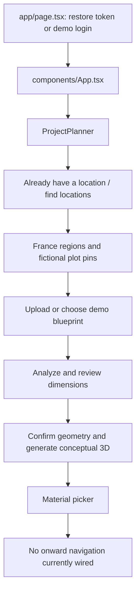

# SustainBuild AI: codebase map and development baseline

Reviewed 2026-10-25 at `134273b224781cb71650e0a71b4e7f0b7cfda395` (`Rename product to SustainBuild`). This is an onboarding record, not a record of implemented fixes.

The repository is a construction-planning demo built on an earlier facility climate-response application. Its useful foundation is a working API, persisted blueprints and projects, conceptual 3D rendering, and deterministic calculations. The latest onboarding UI does not currently connect all of those capabilities into one complete journey.

## Checkout and validation

The ordinary Git clone failed because the terminal could not resolve GitHub. The checkout and complete 12-commit `main` history were retrieved through the GitHub connector instead. Every imported blob, tree, and commit was verified against its original Git SHA. `git fsck --full` passes; the repository is not shallow. `origin` points to the original GitHub repository, and `main` tracks `origin/main`.

Dependencies are installed in `backend/.venv` (Python 3.12.12) and `frontend/node_modules` (installed using Node 25.2.1/npm 11.6.2). No application source was changed during this review. npm's incidental lockfile metadata changes were reverted.

| Check | Observed result |
| --- | --- |
| Backend `python -m pytest -q` | All 10 existing tests pass |
| Frontend `npm run typecheck` | Pass |
| Frontend `npm run build` | Pass; CSS warning about `end` versus `flex-end` |
| Fresh database `alembic upgrade head` | Fails in revision 0002: `table warnings already exists` |
| API startup through TestClient | Pass; schema and synthetic demo data initialize |
| Browser walkthrough | Not performed: local server binding was denied by the execution sandbox |
| Live blueprint AI request | Not exercised; demo extraction was exercised |
| PostgreSQL | Not exercised |

The production build reports approximately 598 kB first-load JavaScript for `/`. npm also emits a vulnerability notice for the pinned Next.js version. No dependency upgrade was performed.

## Product evolution and active entry point

The history explains the overlapping architecture: facility resilience platform → six-hazard response dashboard → construction sandbox → project planner → France map onboarding → plan upload/material picker → AI blueprint review → SustainBuild rename.

The active frontend path is:



`Overview`, `Explore`, `Sites`, `Reports`, and `stormtwin/StormTwin` remain in the repository but are not mounted by the current `App`. The planner also contains Site Intelligence, Simulator, Sustainability, and Reports sections, which are distinct from those legacy components.

The README's Japan school walkthrough and much of `IMPLEMENTATION_PROGRESS.md` describe earlier states. The current entry flow forces France, auto-logs into the demo account, and ends at the material picker.

## Where changes belong

| Area | Main files | Responsibility |
| --- | --- | --- |
| Entry/authentication | `frontend/app/page.tsx`, `frontend/lib/api.ts` | Demo login, localStorage bearer token, fetch wrapper |
| Current product | `frontend/components/planner/ProjectPlanner.tsx` | Navigation, onboarding, all planner state, API orchestration, screen markup |
| Candidate map | `frontend/components/planner/CandidateMap.tsx` | MapLibre, OSM tiles, region-to-three-plots drill-down |
| Conceptual scene | `frontend/components/planner/ProjectSimulation.tsx` | React Three Fiber block rendering and animated hazards |
| Styling | `frontend/app/globals.css` | Original styles plus several successive theme/workflow overrides |
| API and business logic | `backend/app/main.py` | All HTTP routes, request schemas, site presets, blueprint analysis, calculations, PDF generation |
| Persistence | `backend/app/models.py`, `backend/app/db.py` | SQLAlchemy tables and request-scoped sessions |
| Demo fixtures | `backend/app/seed.py` | Demo account, six facilities, assets, weather series, warnings, actions, SVG plan |
| Older risk calculation | `backend/app/scenario.py` | Deterministic asset exposure and loss ranges |
| Schema changes | `backend/alembic/` | Four migration revisions; currently inconsistent with current metadata |
| Verification | `backend/tests/` | Ten API integration tests; no frontend end-to-end suite |

The frontend uses Next.js 14/React 18/TypeScript; the API uses FastAPI/Pydantic/SQLAlchemy. Zustand and Recharts mainly support the legacy StormTwin experience. The current planner uses local React state, not the Zustand store. It has no URL-based section routing.

## Data ownership and persistence

`User` owns `ConstructionProject` and `Facility`. A facility owns assets, weather events, warnings, preparation plans, scenarios, blueprints, and related records. Weather events contain time-series readings. Preparation plans contain items referencing an action catalogue. Scenarios have JSON results. Blueprints have marker rows and an `extracted_data_json` object containing analysis, confirmed geometry, and generated model. Reports reference users and facilities and store a local PDF path.

Construction projects store a name/type/region, selected site IDs, active section, and a free-form `project_data_json`. The facility and blueprint links inside this JSON are not foreign keys. Most of the current planner's state is persisted by replacing this JSON object through PATCH, rather than by separate domain records.

The API's project list is ordered by `updated_at`. The UI loads only the first project into the workspace, then overrides its saved section with the welcome screen. There is no rendered project switcher or explicit new-project reset, even though a project list is held in state. `ensureProject()` reuses the current project whenever one exists.

SQLite is the default, relative to the backend working directory. PostgreSQL can be selected through `DATABASE_URL`, but the requirements file does not include a PostgreSQL driver. Compose starts only PostgreSQL, not the application. Uploaded plans and generated reports live in `backend/uploads`; there is no object storage or background job system.

## Main workflows and calculations

### Candidate search

`POST /api/candidate-sites/search` ranks 13 static presets: eight Japan and five France records. The UI selects the five France records. The map is real; the candidate land inventory, hazard values, planning constraints, air quality, and regional emissions are synthetic.

Eligibility checks minimum plot area and footprint against the coverage ratio. Balanced ranking weights are 50% hazard, 20% environment, 15% sustainability, 15% planning. Alternative priorities adjust those weights. Building type and floor count are accepted but do not affect ranking; floor-area ratio is displayed but not enforced. Ineligible results are sorted lower rather than removed. An unrecognized region falls back to all presets.

`regionalPlots()` synthesizes three smaller plots by offsetting coordinates and scaling area. All three retain the same parent site ID. Backend simulation and sustainability therefore operate on the parent preset, not distinct parcel records.

### Blueprint to model

1. A facility is created as the persistence anchor when a plot is selected.
2. `POST /api/facilities/{id}/blueprints` accepts PDF/PNG/JPEG up to 8 MB, writes a hash-named local file, and creates a Blueprint row. Validation checks the supplied MIME type, not decoded file contents.
3. `POST /api/blueprints/{id}/analyze` optionally sends the file to the OpenAI Responses endpoint via synchronous httpx, with a strict JSON output schema and a 90-second timeout. It requests dimensions, room labels/areas, confidence, assumptions, and uncertainties.
4. With no key, an unsupported demo SVG, or a caught request/parse failure, analysis uses a deterministic building-type profile. The UI labels this Demo Extraction. All sample plan types reuse the same seeded SVG image.
5. `PUT /api/blueprints/{id}/geometry` stores user-confirmed dimensions and zones.
6. `POST /api/blueprints/{id}/generate-model` creates a rectangular main block plus generic zone blocks, or falls back to markers/preset layouts if geometry is absent. Roof area is width × depth. This is conceptual extrusion, not recovered architectural wall/room topology or BIM.

The UI confirmation step is not an API invariant: model generation without confirmation returned HTTP 200 during review. Analysis and geometry updates also do not invalidate a previously stored model. The UI's Commercial sample button calls the school demo profile. PDF preview in the older BlueprintPanel is a filename placeholder.

### Hazards and adaptation

`POST /api/simulations/run` is stateless. It classifies user intensity with fixed thresholds for rain, flood, wind, heat, wildfire, and earthquake. Flood before/after comparison checks water depth against baseline and adapted floor elevations. Site hazard scores are returned as context; they do not drive the intensity classification.

No building geometry is submitted to this endpoint. Equipment elevation and orientation are accepted but unused in the calculation; changing both produced identical responses. Unknown hazard strings are accepted. The scene animates rain/wind/fire/shaking and places a flood plane. The timeline slider is not connected to simulation state or scene time. Orientation and horizontal position affect graphics, not modeled hazard consequences.

The older `/api/scenarios` workflow is different: it persists asset exposure and estimated losses. `calculate_exposure()` uses fixed hazard severity and asset-type coefficients, reducing exposure by 9% per distinct selected action up to 48%. It counts action IDs without validating their existence or suitability. Two nonexistent IDs produced a 0.18 protection modifier in an isolated review check. Preparation plans come from a deterministic catalogue, not an AI planner.

### Sustainability and materials

`POST /api/sustainability/calculate` computes annual rainwater potential as roof area × annual rainfall / 1000 × collection efficiency. It returns `annual potential - tank capacity` as overflow potential, without time-series rainfall, demand, or tank cycling.

Embodied carbon is a simple weighted sum of material tonnes using fixed factors: concrete 0.13, steel 1.85, timber 0.11, insulation 2.4 tCO2e/t. The material picker is a separate frontend points system. Its choices do not change those quantities/factors or the rendered model. Its maximum possible score is 86 although displayed against 100, and its 70-point sustainability target is a hardcoded demo rule.

### Reports

`POST /api/construction-projects/{id}/report` reads the project's saved JSON and writes a ReportLab PDF with requirements, selected IDs, geometry, simulations, adaptations, and sustainability. It does not recompute or validate that evidence. The legacy report is a short summary page.

The project report serializes nested data using Python string representations and wraps at 96 characters. Page overflow is checked once per section value, not once per wrapped line; a large simulations payload can run below the page. Reports do not have a direct project foreign key, and the current UI's generated report reference is not restored on reload.

## Concrete gaps to address before extending the journey

| Priority | Finding and consequence | Evidence |
| --- | --- | --- |
| First | Fresh migrations fail. Revision 0001 imports live models and creates the entire current schema; later revisions recreate warnings, add an existing owner column, and recreate projects. Startup/tests use `create_all`, masking this. | Reproduced on a fresh temporary SQLite database; `backend/alembic/versions/` |
| First | Onboarding cannot reach later planning screens. Navigation is hidden for `projects` and `locations`; materials remains under `locations` with no Continue action. | `ProjectPlanner.tsx`, navigation and materials branches; source trace |
| First | The active onboarding path never invokes project `save()`. The initial project persists, but selected plot, facility link, blueprint/model snapshot, and subsequent state are not attached to its JSON through this journey. | `ensureProject`, `chooseMapLocation`, `confirmAndGenerate`, `save` |
| First | Material choices and chosen plot detail are absent from serialization. Plot identity is shared between three displayed parcels. `chosenPlot` overrides later `activeSiteId` changes. | `projectData`, `loadProject`, `activeSite`, `CandidateMap.regionalPlots` |
| Next | Error handling is inconsistent. Several request functions leave `busy`/`searching` set on failure; automatic login failure is silent, and entry actions can be used before session readiness. | `app/page.tsx`, planner request handlers |
| Next | Model confirmation, model invalidation, and run provenance are weak. Runs are keyed only by site ID and hazard, overwriting earlier variants. Replacing geometry need not invalidate saved results. | Blueprint routes; `runs` state in planner |
| Next | Project report creation accepts a foreign user's facility ID from project JSON. Direct facility reads correctly reject it, but report creation returns 200. | Reproduced using an isolated second-user fixture; `create_project_report` |
| Next | Demo authentication is unsuitable for separate real accounts: fixed-salt SHA-256 hashing, a default signing secret, automatic shared demo login, and public demo credentials. Login and `/auth/me` return the password hash because `as_dict` serializes every column. Logout does not revoke the JWT. | Hash disclosure reproduced; `seed.password_hash`, auth routes |
| Next | SQLite foreign keys are disabled, despite cascade declarations. Deletion/reset can leave orphaned records; upload files have no deletion lifecycle. | `PRAGMA foreign_keys` returned 0; `db.py` |
| Later | Current files concentrate unrelated responsibilities and contain successive UI generations. This increases the chance of fixing a dormant component instead of the active flow. | 877-line API module, densely packed planner, accumulated global CSS |

Other state gaps: calculator inputs, selected hazard/intensities, report reference, and material choices are not restored. Horizontal offset is saved but not loaded. Results can remain visible after changing inputs/site until rerun. Search requirements and blueprint dimensions are separate state, with no consistency check between requested footprint and confirmed building.

## Development starting point

A useful first increment is a complete, persistent journey: select a distinct plot → upload/review blueprint → generate model → choose materials → reach simulations/sustainability → save/reopen → export. Stabilize migrations alongside that work. Introduce an explicit, versioned project-state schema and stable plot IDs before adding more fields to the JSON snapshot.

The next targeted tests should cover fresh migrations, the complete browser journey, refresh/reopen at each step, cross-user links, and the geometry-confirmation lifecycle. Existing tests cover useful API happy paths, but the test named ownership only checks a nonexistent ID; they do not cover browser navigation, migrations, live AI, or multi-user isolation.

Extract modules as those features are touched: planner sections and persistence hook on the frontend; routers/services for projects, blueprints, simulations, sustainability, and reports on the backend. Keep a clear separation between demo fixtures, incoming evidence, user-confirmed geometry, and calculated results.

## Local commands

The current defaults allow demo startup without an `.env` file. From the repository root, in separate terminals:

```sh
cd backend
.venv/bin/python -m uvicorn app.main:app --reload --port 8000
```

```sh
cd frontend
npm run dev
```

Backend startup currently creates the schema directly and seeds demo data. This bypasses the broken migrations; it does not repair them. If using environment files, explicitly load/export their values (for example uvicorn's `--env-file .env` after creating `backend/.env`). Merely copying the root `.env.example` is insufficient: application code does not call `load_dotenv`.

Verification commands:

```sh
cd backend
.venv/bin/python -m pytest -q
```

```sh
cd frontend
npm run typecheck
npm run build
```

The local demo database and generated files are ignored by Git. No development servers were left running after this review. The sandbox prevented binding port 8000, so startup and workflow behavior were checked through FastAPI TestClient rather than a browser session.
